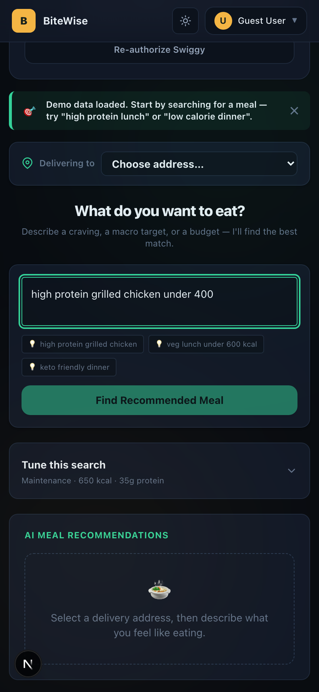
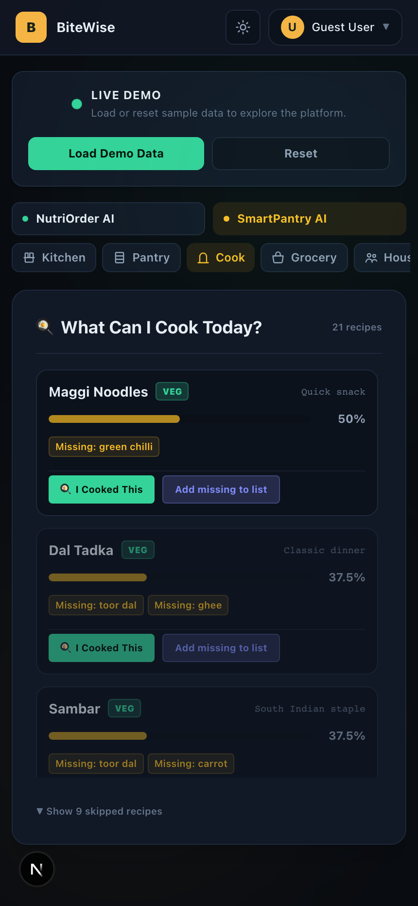
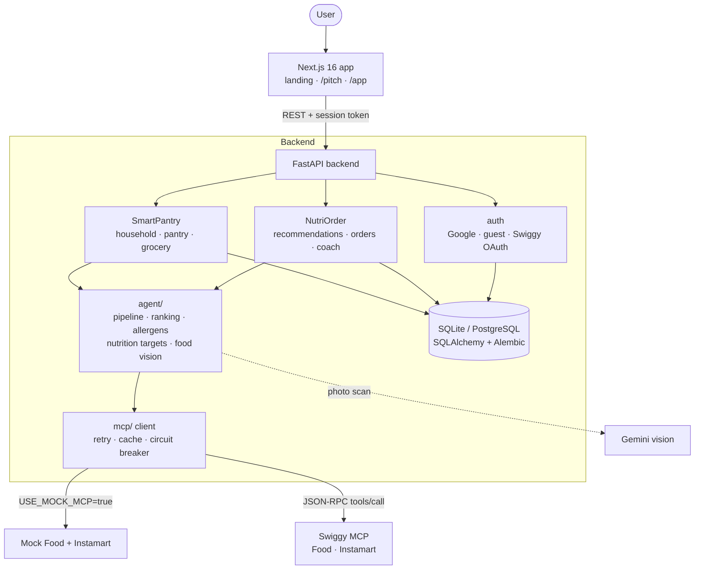
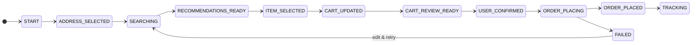
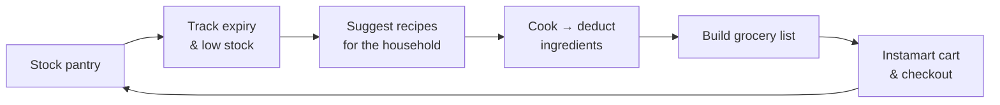

<a id="readme-top"></a>

<p align="center">
  
</p>

<h1 align="center">BiteWise</h1>

<p align="center">
  <strong>Food intelligence on top of Swiggy MCP.</strong><br />
  Order meals that fit your goals. Run a kitchen that never runs out.
</p>

<p align="center">
  <a href="#quick-start"><strong>Quick start</strong></a> ·
  <a href="#how-it-works"><strong>How it works</strong></a> ·
  <a href="#safety-model"><strong>Safety model</strong></a> ·
  <a href="#deployment"><strong>Deployment</strong></a> ·
  <a href="https://mcp.swiggy.com/builders/docs/"><strong>Swiggy MCP docs</strong></a>
</p>

<p align="center">
  <a href="https://github.com/samadarsh/BiteWise/actions/workflows/ci.yml"></a>
  
  
  
  
  <a href="LICENSE"></a>
</p>

---

## Why BiteWise

Food apps are good at showing you what's nearby. They don't know that you're
cutting to 1,800 kcal, that your daughter is allergic to peanuts, or that the
paneer in your fridge expires on Thursday.

BiteWise puts that context in front of Swiggy. One FastAPI backend and one
Next.js app serve two products:

| | Product | What it does |
|---|---|---|
| 🥗 | **NutriOrder AI** | Health-aware food ordering. It ranks real Swiggy Food dishes against your calorie, protein, diet and budget targets, then walks you through a reviewed, confirmed checkout. |
| 🏡 | **SmartPantry AI** | Household pantry intelligence. It tracks stock and expiry, suggests what to cook from what you have, and turns the gaps into an Instamart cart. |

Swiggy MCP is the execution layer: search, cart, coupons, order placement and
tracking all go through the official tools. Everything runs against a
faithful mock by default, and real orders sit behind explicit safety locks.

<p align="center">
  
  &nbsp;&nbsp;
  
</p>

## Features

### 🥗 NutriOrder AI

- **Natural-language search.** Type "high protein lunch under ₹300" and BiteWise searches Swiggy at your chosen address. It uses `search_menu` first and falls back to `search_restaurants` plus menus.
- **Explainable ranking.** Every dish gets a score from ten weighted factors: protein density, calories, fitness goal, diet, cuisine, budget, delivery time, rating, popularity and your order history. Each card shows why it ranked where it did.
- **Personal targets.** Daily calories and protein come from the Mifflin–St Jeor equation, using your age, sex, weight, height, activity level and goal.
- **Allergen safety.** Dishes that conflict with your declared allergies are dropped before scoring, not just flagged. Broad labels like "Nuts" or "Dairy" are expanded into the ingredient words that signal them.
- **Guided checkout.** The flow runs as a strict state machine: address → search → item → cart review → explicit confirm → place → track. It covers coupons from `fetch_food_coupons` and live status from `track_food_order`.
- **Nutrition coach.** Log meals by hand or **snap a photo** (Gemini vision estimates the dish and its macros). You also get a weight trend, weekly trends and a "what should I eat next" suggestion based on what's left in today's budget.

### 🏡 SmartPantry AI

- **Household profiles.** Members carry their own diets and allergies, and recipe suggestions respect all of them at once.
- **Pantry with expiry.** Quick-stock from a 43-item Indian kitchen template. Expiry defaults are set per category, and "use it soon" alerts flag what's about to go off.
- **Cook today.** Thirty recipe templates are matched against what's actually in stock. Cooking one deducts its ingredients from the pantry.
- **Smart grocery list.** Low-stock items and missing recipe ingredients are grouped by aisle.
- **Instamart cart.** The list resolves to real products via `search_products`. You preview the cart, then check out through `checkout` once the safety locks allow it.

### 🧩 Platform

- **Sign-in options.** Sign in with Google, continue as a guest, or connect Swiggy separately through OAuth 2.1 + PKCE, with dynamic client registration.
- **Encrypted tokens.** Swiggy tokens are encrypted at rest with AES-256-GCM and never reach the browser.
- **Revocable sessions.** Session tokens are HMAC-signed, last 30 days, renew automatically and can be revoked server-side.
- **Resilience.** The Swiggy client retries, caches, opens a circuit breaker and falls back cleanly. A Swiggy outage degrades the experience rather than crashing it.
- **Observability.** Every MCP call emits structured JSON logs and timings, with optional Sentry.

<p align="right"><a href="#readme-top">↑ back to top</a></p>

## How it works

### System map



### Ordering flow

A food order can only move forward one step at a time. The cart must be reviewed
and explicitly confirmed before anything is placed, and a failure can be
recovered without starting over.



### Pantry loop



Further reading: [`ARCHITECTURE.md`](ARCHITECTURE.md) covers OAuth, token
storage and the state machine in depth.

## Tech stack

| Layer | Built with |
|---|---|
| **Frontend** | [Next.js 16](https://nextjs.org/) (App Router) · [React 19](https://react.dev/) · [Tailwind CSS v4](https://tailwindcss.com/) · [Framer Motion](https://motion.dev/) · [lucide-react](https://lucide.dev/) |
| **Backend** | [FastAPI](https://fastapi.tiangolo.com/) · [Pydantic v2](https://docs.pydantic.dev/) · [httpx](https://www.python-httpx.org/) · Uvicorn / Gunicorn |
| **Data** | [SQLAlchemy 2](https://www.sqlalchemy.org/) · [Alembic](https://alembic.sqlalchemy.org/) · SQLite (dev) · PostgreSQL via [psycopg 3](https://www.psycopg.org/) (prod) |
| **AI** | Custom ranking + nutrition engine · [Google Gemini](https://ai.google.dev/) (`google-genai`) for food-photo analysis |
| **Integrations** | [Swiggy MCP](https://mcp.swiggy.com/builders/docs/): Food & Instamart over JSON-RPC 2.0 · Google Sign-In |
| **Security** | OAuth 2.1 + PKCE · AES-256-GCM (`cryptography`) · HMAC session tokens |
| **Quality** | pytest · ESLint · Playwright · GitHub Actions · Sentry |

## Quick start

### Prerequisites

- **Python 3.12**
- **Node.js 20+** (CI runs Node 26)
- No Swiggy account is needed: mock mode is the default.

### 1. Backend

```bash
git clone https://github.com/samadarsh/BiteWise.git
cd BiteWise

python3.12 -m venv .venv
source .venv/bin/activate
pip install -r requirements.txt

cp .env.example .env          # mock mode works out of the box
alembic upgrade head          # create / migrate the database
uvicorn backend.main:app --port 8000 --reload
```

The API is now on <http://localhost:8000>, with interactive docs at <http://localhost:8000/docs>.

### 2. Frontend

```bash
cd frontend
npm install
npm run dev
```

Open <http://localhost:3000>, choose **Continue as Guest**, then click
**Load Demo Data** to load a ready-made profile, pantry and household.

> [!TIP]
> Want the two-minute tour? Visit **`/pitch`** for a guided walkthrough of both
> products, or follow [`DEMO_GUIDE.md`](DEMO_GUIDE.md).

### Configuration

The defaults in `.env.example` run everything locally against the mock. These are the variables you'll touch most:

| Variable | Default | Purpose |
|---|---|---|
| `USE_MOCK_MCP` | `true` | Use the built-in Swiggy mock. Set to `false` to call real Swiggy MCP. |
| `SWIGGY_ENV` | `mock` | `staging` is required, alongside `ALLOW_PLACE_ORDER`, before any real order. |
| `ALLOW_PLACE_ORDER` | `false` | Master switch for real order placement. |
| `DATABASE_URL` | `sqlite:///./nutriorder.db` | Use a `postgresql+psycopg://…` URL in production. |
| `ENCRYPTION_KEY` | dev key | 32-byte key (64 hex chars or base64) for token encryption. **Replace in production.** |
| `SESSION_SECRET` | *(empty)* | HMAC secret for session tokens. |
| `SWIGGY_CLIENT_ID` | *(empty)* | Leave blank to use dynamic client registration. |
| `SWIGGY_REDIRECT_URI` | `http://localhost:8000/auth/swiggy/callback` | OAuth callback on the backend. |
| `FRONTEND_BASE_URL` | `http://localhost:3000` | Where users are sent back after OAuth. |
| `CORS_ALLOWED_ORIGINS` / `CORS_ALLOWED_ORIGIN_REGEX` | localhost | Allowed browser origins. The regex is handy for Vercel preview URLs. |
| `GOOGLE_CLIENT_ID` | *(empty)* | Enables Google Sign-In. |
| `GEMINI_API_KEY` | *(empty)* | Enables food-photo scanning in the coach. |
| `SENTRY_DSN` | *(empty)* | Optional error reporting. |

The frontend reads `NEXT_PUBLIC_API_URL` (default `http://localhost:8000`) and `NEXT_PUBLIC_GOOGLE_CLIENT_ID`.

<p align="right"><a href="#readme-top">↑ back to top</a></p>

## Safety model

BiteWise can place real orders on a real Swiggy account, so placement is
locked down in layers. **All** of these must pass:

1. **Live mode.** `USE_MOCK_MCP=false`. Otherwise every call is served by the mock.
2. **Staging environment.** `SWIGGY_ENV=staging`.
3. **Explicit opt-in.** `ALLOW_PLACE_ORDER=true`.
4. **Human confirmation.** The order state machine refuses to place anything that hasn't gone through cart review and an explicit confirm.
5. **Spend cap.** Carts of ₹1000 or more are blocked, matching Swiggy MCP's limit.
6. **Cash on delivery only.** BiteWise never starts a UPI flow. A UPI order comes back `PENDING_PAYMENT`, which is not a placed order.
7. **Duplicate guard.** A second checkout within a minute of the last one is rejected, for both Food and Instamart.

Demo seed and reset are hidden whenever a user is connected in live mode, so
fabricated data never mixes with a real account. See
[`STAGING_READINESS.md`](STAGING_READINESS.md) before switching anything on.

## Testing

```bash
# Backend: 165 tests covering ranking, allergens, OAuth/PKCE, MCP response shapes, checkout locks…
python -m pytest agent/tests/ -q

# Frontend: lint and production build
cd frontend && npm run lint && npm run build

# End-to-end smoke tests against a running backend
python scripts/smoke_test.py --mode mock --journey coach
python scripts/smoke_test.py --mode mock --journey household

# Environment sanity check
python scripts/dev_check.py
```

[GitHub Actions](.github/workflows/ci.yml) runs the backend tests, frontend lint
and build on every push and pull request.

## Deployment

The reference setup is **Vercel** for the frontend and **Render** (or any Docker
host) for the API.

| Piece | How |
|---|---|
| **API** | [`render.yaml`](render.yaml) blueprint (Gunicorn + Uvicorn worker, single worker), or the [`Dockerfile`](Dockerfile). |
| **Database** | Point `DATABASE_URL` at PostgreSQL and run `alembic upgrade head` on release. Render's free disk is wiped on restart, so SQLite won't persist there. |
| **Frontend** | Import `frontend/` into Vercel and set `NEXT_PUBLIC_API_URL` to the API URL. |
| **CORS / OAuth** | Add the frontend origin to `CORS_ALLOWED_ORIGINS` (or `CORS_ALLOWED_ORIGIN_REGEX` for previews). Set `FRONTEND_BASE_URL` and `SWIGGY_REDIRECT_URI` to the deployed URLs. |

Full walkthroughs: [`DEPLOYMENT_GUIDE.md`](DEPLOYMENT_GUIDE.md) ·
[`POSTGRES_MIGRATION.md`](POSTGRES_MIGRATION.md).

## Project structure

```text
BiteWise/
├── backend/            FastAPI app: main.py + one package per domain
│   ├── auth/             Google / guest sign-in, sessions, Swiggy OAuth + PKCE
│   ├── recommendations/  NL search → ranked dishes
│   ├── orders/           order state machine, coupons, place & track
│   ├── coach/            food log, photo scan, weight & trends
│   ├── household/        members, cook-today, insights
│   ├── pantry/           stock, expiry, kitchen template
│   └── grocery/          grocery list, Instamart cart & checkout
├── agent/              ranking, allergens, nutrition targets, food vision,
│                       resilience, caching, observability (+ tests/)
├── mcp/                Swiggy MCP client and Food / Instamart mocks
├── alembic/            database migrations
├── frontend/           Next.js app (app/, components/, lib/)
├── scripts/            smoke tests, dev checks, DB backup
└── docs/deliverables/  platform overview & recording script
```

## Documentation

| Doc | What's in it |
|---|---|
| [`ARCHITECTURE.md`](ARCHITECTURE.md) | OAuth, token encryption, address picker, order state machine |
| [`DEPLOYMENT_GUIDE.md`](DEPLOYMENT_GUIDE.md) | Vercel + Render setup, environment variables |
| [`POSTGRES_MIGRATION.md`](POSTGRES_MIGRATION.md) | Moving from SQLite to PostgreSQL |
| [`STAGING_READINESS.md`](STAGING_READINESS.md) | Checklist before enabling real Swiggy calls |
| [`DEMO_GUIDE.md`](DEMO_GUIDE.md) · [`DEMO_SCRIPT.md`](DEMO_SCRIPT.md) | Running a live demo |
| [Swiggy Builders Club docs](https://mcp.swiggy.com/builders/docs/) | Authoritative reference for every Swiggy MCP tool |

## Contributing

Issues and pull requests are welcome. Before opening a PR:

1. Keep changes running in **mock mode**. Never commit real tokens or flip safety-lock defaults.
2. Run `python -m pytest agent/tests/ -q`, then `npm run lint && npm run build` in `frontend/`.
3. Check Swiggy tool names and parameters against the
   [Builders Club reference](https://mcp.swiggy.com/builders/docs/reference/food/index.md) rather than guessing.
4. `frontend/` uses Next.js 16, which has breaking changes from earlier versions. Read the guides in
   `frontend/node_modules/next/dist/docs/` before touching framework APIs.

## License

BiteWise is released under the [MIT License](LICENSE).

<p align="right"><a href="#readme-top">↑ back to top</a></p>
